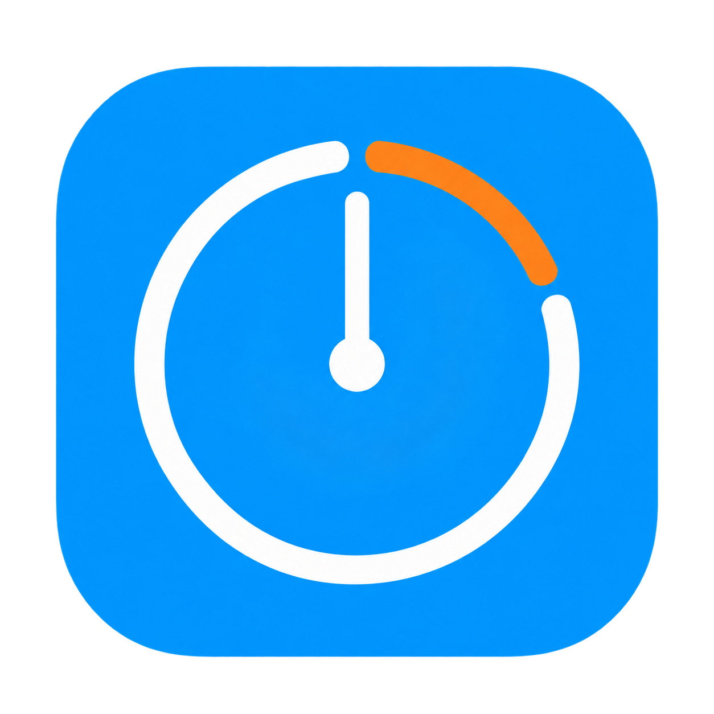

# PPT Timer · PPT 浮动计时器

一个轻巧的 macOS 演示计时器。浮动在幻灯片上方，支持倒计时、正计时、暂停和超时显示。



## 下载使用

[直接下载最新版](https://github.com/andy-jwyan/ppt-timer/releases/latest/download/PPT-Timer-macOS-arm64.zip)，或在 [Releases](https://github.com/andy-jwyan/ppt-timer/releases) 页面下载 `PPT-Timer-macOS-arm64.zip`，解压后把 **PPT倒计时.app** 拖入「应用程序」，双击打开。无需安装开发工具。

- 支持 **Apple 芯片（M1 及更新）Mac，macOS 13 或更高版本**。目前不提供 Windows 或 Intel 版。
- 应用未经过 Apple Developer ID 签名和公证。首次打开可能被系统拦截；确认下载来自本仓库后，可在「系统设置 → 隐私与安全性」中点击「仍要打开」。受管理的电脑可能不允许此操作。
- 已在开发者本机 macOS 26 验证运行；macOS 13–15 兼容性尚未实机验证。

## 功能

- **倒计时**：15、10、8、5 分钟预设，也可以自定义分钟数。
- **超时计时**：归零时提示音一次，随后继续显示 `-00:01`、`-00:02`。
- **正计时**：从 `00:00` 向上累加。
- 两种模式都支持开始、暂停、继续和重置。切换模式会停止并重置当前计时。
- 小窗口支持拖动和精简模式。倒计时最后 3 分钟变橙，最后 1 分钟及超时变红。
- 配置了跨桌面和全屏辅助窗口，可放在 PPT 上方。不同放映软件和多屏组合请提前试用。

先打开计时器，再播放幻灯片，并把窗口拖到需要的屏幕角落。屏幕镜像或共享整个屏幕时，观众也会看到计时器。

## 从源码构建

需要 macOS 和 Xcode Command Line Tools（`xcode-select --install`）。无第三方依赖。

```sh
./重新编译.command
```

生成根目录下的 `PPT倒计时.app`。当前构建目标为 Apple 芯片、macOS 13+。

在可访问桌面的本机终端运行功能自检：

```sh
./PPT倒计时.app/Contents/MacOS/PPTTimer --self-test
```

自检覆盖预设、自定义时长、暂停继续、超时、正计时、模式切换、重置和精简模式。全屏覆盖效果需在实际演示环境验证。

## 许可

[MIT](LICENSE)。图标通过 AI 辅助设计生成，随项目提供。
